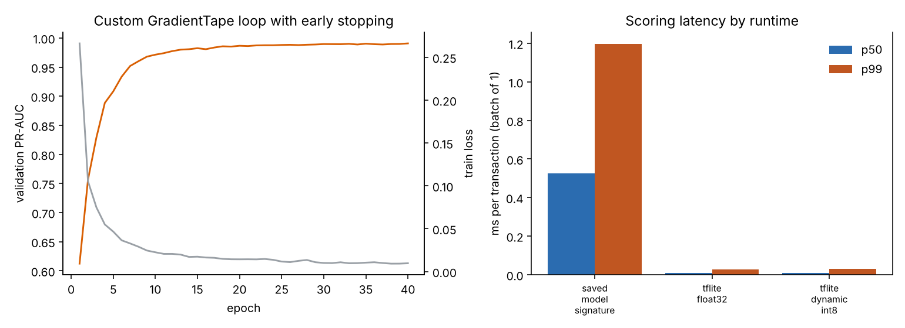

# fraud-detection-tensorflow

Card-fraud scoring written directly in **TensorFlow**, with no Keras layers: a `tf.Module` network,
a `tf.data` pipeline, a hand-written training loop with `tf.GradientTape` and Adam, preprocessing
**inside the graph**, then export to **SavedModel and TFLite** with checks that exporting and
quantising did not change a single decision, and a per-transaction **latency** measurement.

Part of a three-repository comparison on identical data and protocol:
[scikit-learn](https://github.com/Volers321/fraud-detection-sklearn) · [Keras](https://github.com/Volers321/fraud-detection-keras) · **TensorFlow** (this repo).



## Why a low-level TensorFlow repo

Fraud scoring sits in the authorisation path of a card payment, so the question is not only
"how accurate" but "how fast, how small, and is the exported model the same model". This repo
answers those and shows the parts of TensorFlow that high-level APIs hide:

* **`tf.Module` + `tf.Variable`** weights, embeddings via `tf.gather`.
* **Preprocessing in the graph** (log, standardisation, clipping use constants stored in the module),
  so the serving signature takes **raw features** and cannot suffer train/serve skew.
* **Custom training step**: `tf.GradientTape`, weighted cross-entropy, L2, a hand-written Adam update,
  compiled with `tf.function`; early stopping on validation PR-AUC (never a random split).
* **Only ops that TFLite supports natively** (`log` instead of `log1p`, arithmetic masks instead of
  `tf.where`), so the same graph converts unchanged.

## Protocol (same in all three repos)

Synthetic card transactions from a simulator (`src/fraudtf/data.py`): 2,500 cards, 90 days,
**208,206 transactions, 0.51% fraud**, four attack patterns. Temporal split: train days 0-59 (613
fraud rows), validation 60-74 (181), test 75-89 (270). The `mule_cashout` attack (117 rows) appears
**only in the test period**. Features use only earlier transactions of the same card (a test proves
it). The alert threshold is the validation score that alarms 0.5% of transactions, applied
unchanged to test. Net savings = amount of stopped fraud minus 5 PLN per reviewed alert.

## Model quality (test period, 34,556 transactions, 270 fraud)

| PR-AUC all | PR-AUC known patterns | Recall | Precision | Alert rate | Net savings | Fraud amount stopped |
|---:|---:|---:|---:|---:|---:|---:|
| 0.847 [0.755-0.924] | 0.982 | 0.722 [0.612-0.827] | 0.956 | 0.59% | 113,193 PLN | 51.5% |

Recall by pattern: card_testing 1.00, takeover 0.90, stolen_card 0.90, **mule_cashout (new) 0.45**.

Same ballpark as the other two repos on the same data: `HistGradientBoosting` 0.969 and the Keras MLP
0.976-0.981 PR-AUC on known patterns; every supervised model finds only 45-47% of the new attack.
The model is a plain MLP (64, 32) with embeddings; the difference between libraries is not accuracy
but what each makes easy.

Training ran to the 40-epoch cap (about 0.8 s per epoch on 2 CPU cores); validation PR-AUC was
still creeping up in the last epochs (best 0.991), so early stopping never fired here.

## Engineering results

**`tf.function` against eager execution** (same training step, 1,024-row batches):

| Mode | ms per step |
|---|---:|
| graph-compiled | 2.45 |
| eager | 23.52 |

About 9.6x faster once compiled; the test suite also checks that both modes compute the same update when dropout is off.

**Export checks** (test period, threshold from validation):

| Artifact | Size | Max score difference vs in-memory | PR-AUC | Same alert decisions |
|---|---:|---:|---:|---:|
| in-memory model | n/a | - | 0.8474 | - |
| SavedModel | 47.1 KB | 0.0 | 0.8474 | 100% |
| TFLite float32 | 19.9 KB | 1e-6 | 0.8474 | 100% |
| TFLite dynamic-range int8 | 10.6 KB | 0.073 | 0.8471 | 99.997% (1 of 34,556) |

Quantising to int8 halves the file again and costs 0.0003 PR-AUC; the largest single score moved by
0.073, which flipped one alert decision out of 34,556.

**Latency, one transaction per call** (Python, 1,500 calls after warm-up, 2-core cloud CPU):

| Runtime | p50 | p99 |
|---|---:|---:|
| SavedModel signature | 0.524 ms | 1.197 ms |
| TFLite float32 | 0.009 ms | 0.026 ms |
| TFLite dynamic int8 | 0.009 ms | 0.031 ms |

For a model this small, TFLite is about 58x faster per call than the SavedModel signature because it
avoids the TensorFlow runtime overhead, and int8 brings no speed gain, only size.

## Caveats

* **Synthetic data**: absolute numbers belong to the simulator, not to real fraud.
* **One simulated dataset and one training seed**; the Keras repo shows how much a neural result moves with the seed (about ±0.004 PR-AUC).
* **Latency is measured from Python on a shared cloud CPU**: it compares runtimes, it is not a
  production serving benchmark (no network, no batching, no Triton/TF Serving).
* The int8 check concerns this one model and threshold; re-verify decisions after every retraining.

## Run it

```bash
pip install -e ".[dev]"
fraudtf eval        # train, evaluate, export, benchmark; writes results/eval.json and docs/eval.png (under a minute on 2 cores)
pytest              # 10 tests
```

Tests cover the no-leakage property, in-graph preprocessing equal to a numpy reference, valid
probabilities, training that reduces loss, eager equal to graph execution, SavedModel round-trip
(scores equal to 1e-5) and TFLite parity with the SavedModel (1e-4).

## Layout

```
src/fraudtf/data.py      simulator and point-in-time features (shared across the three repos)
src/fraudtf/metrics.py   PR-AUC, alert budget, net savings, per-pattern recall, card bootstrap (shared)
src/fraudtf/net.py       tf.Module network, hand-written Adam, training step and loop
src/fraudtf/serving.py   SavedModel / TFLite export, scorers, latency helper
src/fraudtf/pipeline.py  protocol, tf.function benchmark, export and latency study
results/eval.json        every number in this README
```

MIT licence.
